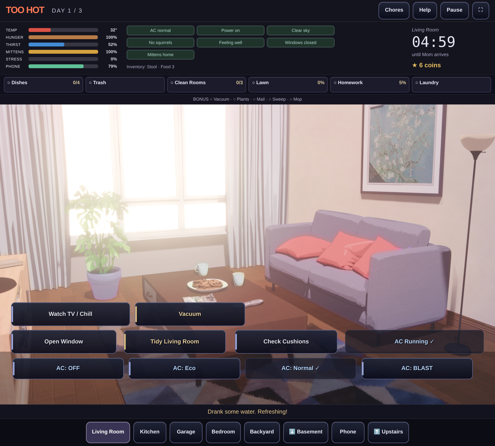

# Too Hot — browser edition

A playable, static HTML/CSS/JavaScript port of the uploaded Java Swing game. No Java runtime, streaming service, emulator, account, or backend is required. The desktop Java source and runner are unchanged. New application code lives entirely in `web/`.



Screenshot captured with Chromium touch emulation, not physical Safari.

## Run on your computer

Install Node.js 22.12+ (Node 24 LTS recommended), then from a terminal in this repository:

```sh
cd web
npm install
npm run dev
```

Open the address Vite prints, normally port **5173**. The server listens on your network so another device can connect. Subsequent reproducible installs can use `npm ci` with the included lockfile.

```sh
npm test          # deterministic rules, actions, progression and minigame tests
npm run build    # refresh original art copies and build dist/
npm run preview  # serve the production build on port 4173
```

The built `dist/` folder is the complete game. Do not open `index.html` directly with `file://`; serve it over HTTP or HTTPS.

## Open on your iPad

1. Run `npm run dev` on your Windows computer.
2. Put the iPad and computer on the **same Wi-Fi network**.
3. On Windows, run `ipconfig` and find the active Wi-Fi adapter’s IPv4 address (for example, `192.168.1.25`). Allow Node.js through Windows Firewall for **private networks** if prompted.
4. In iPad Safari, enter your computer’s IPv4 address with port `5173`, for example `http://192.168.1.25:5173`.
5. Rotate to landscape. Tap room and action buttons; no hover or physical keyboard is required. You can scroll when using a smaller viewport. Fullscreen is optional and browser-dependent.

Use your computer’s LAN address, not `localhost` on the iPad. Guest Wi-Fi isolation, VPNs, or a firewall may block local device access. A computer running inside a cloud workspace is not on your home Wi-Fi; for that case, use an HTTPS deployment below. No cloud-workspace preview URL is provided by this project.

## Publish online

Use GitHub Pages, Netlify, Cloudflare Pages, or another static HTTPS host:

- **Build directory:** `web`
- **Install command:** `npm ci`
- **Build command:** `npm run build`
- **Publish/output directory:** `web/dist` relative to the repository, or `dist` when the host’s base directory is `web`.

For GitHub Pages, build from `web/` in a GitHub Actions workflow, upload `web/dist` as the Pages artifact, and deploy it through the repository’s Pages settings. For Netlify/Cloudflare, connect the repository and use the settings above. The Vite base is relative (`./`), so a repository subpath is supported. After deployment, open the host-provided **HTTPS** address on Safari and Windows browsers. Publishing has not been performed by this coding task.

Assets must be present during the build. Deploy `dist/`, including its `assets/` directory and credits; deploying just `web/index.html` will not work. There are no server routes or environment secrets.

## Controls and gameplay

- Tap/click rooms and actions. Desktop keyboard: **1–9** selects rooms; **P** opens the phone; **Escape** pauses or closes the current overlay. **Tab/Enter** operate buttons.
- Dishes: tap **SCRUB** or press **Space** while the needle is in the green zone. Four successful hits finish the dishes; too many misses reset progress.
- Roaches: tap all six targets in twelve seconds. Fuse box: watch and repeat three memory sequences; wrong input repeats the round. Fuse keys are **1–7**.
- Nightmare: repeat three circuits using taps or **A–F**. A wrong node or time running out is fatal. The path hint remains visible, as in Java.
- Phone: messages, deliveries, music effects, charging and Flappy Bird. Tap its canvas or use focused **Space/Arrow Up** to flap. Music affects stats; the original Java never played audio, so this port is also silent.
- Get the **stool** from the bedroom to reach the kitchen sink. Get **spray** from Mom’s dresser, clear garage roaches, take the **wrench**, then repair the AC.
- Finish six main chores: dishes, trash plus replacement bag, three tidy rooms, lawn, homework, laundry. Bonus jobs earn coins immediately. The Chores button explains each chain.
- Survive until Mom arrives, collect allowance, shop between days, then survive all three days. All original stat failures and nightmare endings are represented.

## Source parity and deliberate browser differences

See [PARITY.md](PARITY.md) for the Java-to-browser mapping, exact values and original quirks. It is an audit, not a blanket parity claim.

The Java timer decrements one displayed second every **500 ms**. This port retains that executable behavior: days last approximately **150, 135 and 120 real seconds**, excluding nightmare/arrival/shop/pause. The original old README’s “five minutes” description is inaccurate.

The interface restores the Java room-specific button positions in their shared 800×455 coordinate system, ground/upstairs/basement navigation, separate Mom/Friend phone conversations, delivery dropdown, TV shop, and illustrated house/car/Mom arrival. The HUD keeps stacked stats on the left, status indicators in the middle, and countdown on the right. Browser usability changes are explicit pause, hidden-tab suspension (including minigames), 44px touch targets, scrolling on short displays, fullscreen fallback, and a flowing layout on small phones. State remains in memory with no autosave, matching Java’s restart behavior. Missing artwork and some illustration details still prevent a pixel-perfect parity claim.

Known Java quirks are retained and described in PARITY: delivery ordering locks after certain purchases, food pickup reappears, generator/medicine-kit/ice-pack upgrades have limited or unused source effects, priority notes do not affect rewards, and homework/laundry can progress during outages. These have not been silently redesigned.

## Artwork and credits

`npm run assets` copies only referenced images into generated `public/assets/`, then the production build includes them. It first prefers the actual Java runtime files in `../assets/rooms/`, then exact runtime names uploaded at the repository root (for example `garage.jpg`), then maps the supplied root-level collection below. Lookup tolerates Windows filename casing. `dist/assets/sources.json` records which input file was selected for each image:

| Game image | Supplied source |
| --- | --- |
| Menu | `outside2.jpg` |
| Living room | `lounge.jpg` |
| Kitchen | `kitchen.jpg` |
| Bedroom | `single bedroom.jpg` |
| Mom’s room | `master bedroom.jpg` |
| Bathroom | `bathroom.jpg` |
| Backyard | `outside1.jpg` |

The uploaded **Spiral Atlas Visual Novel House Backgrounds © 2023 by Spiral Atlas** are licensed under [CC BY 4.0](https://creativecommons.org/licenses/by/4.0/). [Credits and acknowledgements](https://spiralatlas.github.io/credits/). Source files are copied unchanged, renamed for game lookup and scaled at display time; no image artwork was retouched. The source `Credits and Information.txt` and `license.txt` are copied into the build. In-game credits are available from the menu and Help.

**Still missing:** original `garage` and `laundry_room` backgrounds, and `cat`, `cat_bowl`, `squirrel`, `closet_interior`, `roach_ai`, `rat`, `sprinkler_on`/`sprinkler_off` sprites. The port uses source-style gradients/drawn fallbacks, not unrelated downloaded art. Gameplay in those rooms is implemented. To restore original visuals, add the original JPG/PNG/JPEG files under root `assets/rooms/` and rebuild; no browser code change is needed. Do not upload the large exploratory `assets/preview` collection. Accompany new art with its original credits/licenses.


The separately attached `vn_house.zip` could not be read because it exceeded this workspace’s 32 MiB attachment-transfer limit. No new artwork from that archive has been included. Send the individual runtime images directly inside your desktop `assets/rooms/` folder (or split them into ZIPs smaller than 32 MiB); nested source collections are not required.

The user’s newly attached Java files match the original uploaded source byte-for-byte, and all 49 subsequently uploaded compiled classes match a recompile in disassembly. An older Java source version was not established. The initial visual mismatch came from missing runtime images and presentation changes made in the first browser port.

## Browser testing and remaining verification

Completed in this workspace: **56 unit tests passed**, **14 browser scenarios passed** (seven desktop Chromium and seven iPad-sized Chromium with touch), production build passed, and production HTTP checks passed for the HTML, all seven supplied JPGs, credits, and absence of development test hooks. Browser scenarios reported no JavaScript page errors. Landscape and portrait touch layouts were exercised. These results do not include Safari or a physical Windows/iPad session.

The automated browser suite uses Playwright, real rendered controls, and development-only hooks to set up rare events and advance long countdowns. The production bundle excludes those hooks. Unit tests include a full three-day action-based simulation with all six daily chores, resource management and shop progression; browser tests separately exercise the actual dish needle, six roach targets and observed fuse/node sequences.

```sh
# Install a test browser if your machine does not have a usable system Chromium:
npx playwright install chromium
npm run test:e2e

# Optional actual Safari-engine check (Linux may need --with-deps):
npx playwright install webkit
# macOS/Linux:
TEST_WEBKIT=1 npm run test:e2e
# Windows PowerShell:
$env:TEST_WEBKIT='1'; npm run test:e2e
```

The default suite runs desktop Chromium and **Chromium with an iPad-sized touch viewport**, which is not Safari. `CHROMIUM_PATH` can select a system executable. The optional project runs actual WebKit. This workspace’s network policy blocked the WebKit download with HTTP403, so WebKit and physical iPad/Safari checks remain unperformed. Test landscape/portrait Safari on a real device after hosting; layout/touch simulation alone does not establish that hardware validation.

This project uses modern browser-native ES modules, Pointer Events, Canvas and CSS; no Java or emulation layer is present. No online deployment or physical Windows/iPad test has been claimed.
